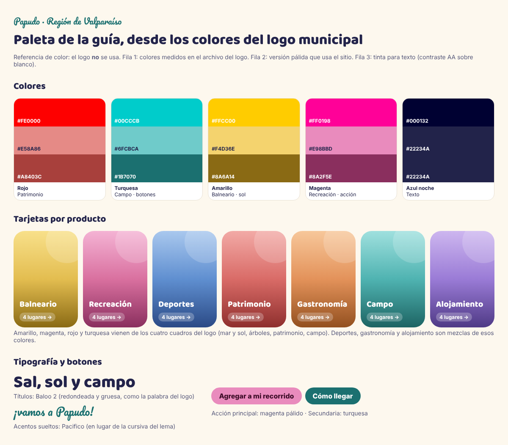

# Marca: colores tomados del logo municipal

> **No es un manual oficial.** El logo «MuniPapudo» se usa **solo como
> referencia de color**: el logo mismo no aparece en la guía (falta
> autorización y decidir cómo se presenta). Del sitio web municipal no se toma
> nada. Confirmar con la municipalidad si se oficializa.

## Colores del logo (medidos en el archivo, 17-10-2026)

Mediana de los píxeles de cada cuadro del logo que entregó el usuario.

| Color      | En el logo | Pálido (sitio) | Tinta (texto) | Uso en la guía                          |
| ---------- | ---------- | -------------- | ------------- | --------------------------------------- |
| Rojo       | `#FE0000`  | `#E58A86`      | `#A8403C`     | Patrimonio; tinta de avisos (`--earth`) |
| Turquesa   | `#00CCCB`  | `#6FCBCA`      | `#1B7070`     | Botones secundarios, enlaces (`--sea`)  |
| Amarillo   | `#FFCC00`  | `#F4D36E`      | `#8A6A14`     | Balneario; sol (`--sun`)                |
| Magenta    | `#FF0198`  | `#E98BBD`      | `#8A2F5E`     | Recreación; acción principal (`--coral`) |
| Azul noche | `#000132`  | `#22234A`      | `#22234A`     | Texto (`--foreground`)                  |

El lema del logo usa turquesa `#22CACA` y la flecha, magenta `#FC0398`.

Los tokens están en `src/app/globals.css`; los degradados de las tarjetas por
producto, en `src/components/ui/category-card.tsx`, y los pines del mapa, en
`src/lib/map-config.ts`. Los cuatro cuadros del logo se asocian a cuatro
productos (amarillo: mar y sol → balneario; magenta: árboles → recreación;
rojo: patrimonio; turquesa: campo → ruralidad). Deportes (azul), gastronomía
(naranja) y alojamiento (lila) son mezclas de esos colores. Los verdes de
campo (`--field`) se mantienen para «Verificado».

## Refresh 2026-11: los cuatro cuadros

Desde noviembre de 2026 el sitio usa **fondo blanco y azul noche** (`#14164A`)
en vez de arena y rosado, y los **cuatro cuadros del logo**, en su color
pleno, son las puertas de entrada: mar y sol (`--cuadro-mar` `#FFC400`),
campo y humedal (`--cuadro-campo` `#00B5B4`), patrimonio
(`--cuadro-patri` `#D71F19`) y paseos y deporte (`--cuadro-paseo`
`#D4087E`). El rojo y el magenta se oscurecieron un poco respecto del logo
para que el texto blanco encima cumpla AA. La acción principal (`--coral`)
pasa a ser azul noche con texto blanco; `--coral-ink` queda como tinta de
avisos y errores.

## Accesibilidad (WCAG AA, texto normal ≥ 4,5:1)

| Combinación                                   | Contraste |
| --------------------------------------------- | --------- |
| Texto `#14164A` sobre blanco                  | 16,9      |
| Texto secundario `#4A4C6E` sobre blanco       | 8,2       |
| Texto secundario `#4A4C6E` sobre `#F4F5F9`    | 7,6       |
| Blanco sobre la acción principal `#14164A`    | 16,9      |
| Blanco sobre turquesa `#0F6D6C` (y al revés)  | 6,1       |
| Azul noche sobre el cuadro mar `#FFC400`      | 10,6      |
| Azul noche sobre el cuadro campo `#00B5B4`    | 6,7       |
| Blanco sobre el cuadro patrimonio `#D71F19`   | 5,1       |
| Blanco sobre el cuadro paseos `#D4087E`       | 5,1       |
| `#3B0A26` sobre amarillo pálido `#F4D36E`     | 11,4      |

Los colores pálidos (y el amarillo y turquesa del logo) nunca van como texto
sobre blanco: solo fondos, bordes o decoración. Sobre el amarillo y el
turquesa de los cuadros, el texto va siempre en azul noche.

## Tipografía

El logo usa una sans geométrica redonda y gruesa para «MuniPapudo» y una
cursiva para el lema. La guía mantiene **Baloo 2** (títulos, de la misma
familia visual) y **Pacifico** (acentos sueltos, en lugar de la cursiva),
autoalojadas con `@fontsource`. Desde el refresh de noviembre de 2026 el
texto corrido usa **Figtree** (`@fontsource-variable/figtree`).
