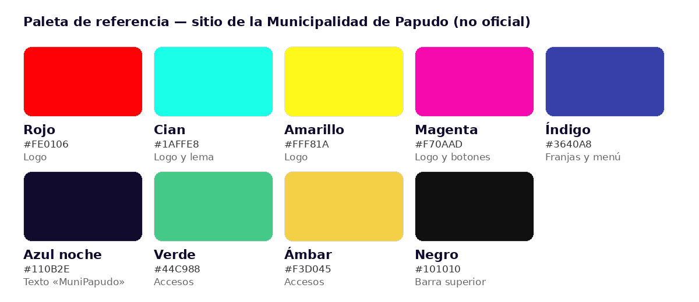

# Marca: referencia de colores (provisoria)

> **No es un manual oficial.** Colores tomados del sitio de la Municipalidad de
> Papudo (grabación del 17-10-2026) y de su logo. Del sitio solo se toman los
> colores: su diseño **no** es referencia para esta guía. El **logo no se usa**
> todavía (falta autorización y decidir cómo se presenta la guía). Confirmar
> los valores con la municipalidad si se adoptan.

## Colores del logo «MuniPapudo»

Los cuatro cuadros del logo y su texto. Valores **medidos** sobre el sitio web
(pantalla, pueden venir saturados); entre paréntesis, el tono que se ve en el
archivo del logo, **estimado a ojo** hasta tener el archivo original.

| Color      | Medido    | En el logo (aprox.) | Uso en el logo                    |
| ---------- | --------- | ------------------- | --------------------------------- |
| Rojo       | `#FE0106` | `#EE1C25`           | Cuadro del castillo               |
| Turquesa   | `#1AFFE8` | `#1CC7CB`           | Cuadro del cerro; lema            |
| Amarillo   | `#FFF81A` | `#FFD100`           | Cuadro del pelícano               |
| Magenta    | `#F70AAD` | `#E5007E`           | Cuadro del campo; flecha del lema |
| Azul noche | `#110B2E` | `#1B1447`           | Texto «MuniPapudo»                |

Complementarios del sitio web: índigo `#3640A8` (franjas), verde `#44C988`,
ámbar `#F3D045`, negro `#101010`.

## Accesibilidad (contraste WCAG con texto normal, mínimo 4,5:1)

| Color      | Sobre blanco | Sobre azul noche | Para texto sobre blanco usar |
| ---------- | ------------ | ---------------- | ---------------------------- |
| Rojo       | 4,0          | 4,7              | `#EA0106`                    |
| Turquesa   | 1,3          | 14,9             | `#0D8276`                    |
| Amarillo   | 1,1          | 16,8             | — (solo fondos o detalles)   |
| Magenta    | 3,8          | 5,0              | `#DC099A`                    |
| Índigo     | 8,6          | 2,2              | tal cual                     |
| Azul noche | 18,9         | —                | tal cual                     |

Reglas prácticas:

- Turquesa y amarillo nunca como texto sobre blanco: van como fondo, detalle
  o sobre azul noche.
- Texto principal en azul noche; magenta y rojo (en sus versiones oscuras)
  para destacar.
- Los cuatro colores del logo juntos identifican a la municipalidad: usarlos
  con moderación (por ejemplo, una franja de cuatro colores), sin competir con
  la paleta propia de la guía (`src/app/globals.css`).

## Tipografía

El sitio municipal usa una sans geométrica redondeada; el logo, una sans
geométrica en negrita y el lema en cursiva. No se adopta: la guía mantiene
Baloo 2 y Pacifico (`docs/DECISIONES.md`).
